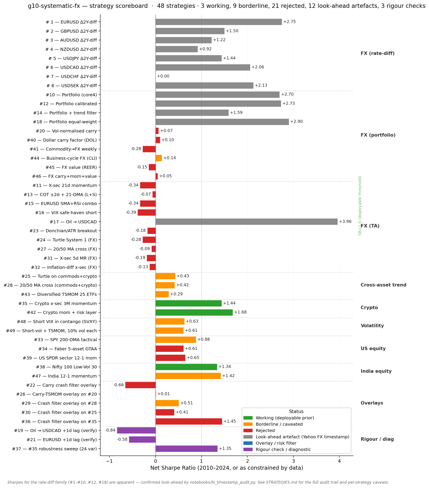

# g10-systematic-fx

A public-data systematic research lab: 48 pre-specified strategies across G10 FX, multi-asset trend, volatility, crypto, US and Indian equities, each tested net of costs and kept in the record whether it worked or not. Built entirely on **public data** (FRED, yfinance, CFTC, BIS, OECD) so every result is reproducible without a Bloomberg Terminal.

**Stack:** Python · pandas · numpy · scipy · statsmodels · matplotlib · yfinance · FRED · CFTC

---

## Strategy scoreboard



*48 strategies tested · 3 working · 8 borderline · rejected and look-ahead artefacts kept in the record. **Every strategy, verdict and caveat: [STRATEGIES.md](STRATEGIES.md).** Regenerate the chart with `python notebooks/strategy_dashboard.py`.*

## What works

| # | Strategy | Net Sharpe | Status |
|---|---|---|---|
| **42** | Crypto cross-sectional momentum + vol-target + BTC 200-DMA regime | 1.68 | ✅ 4/4 criteria; MaxDD −43%; positive in the 2025+ hold-out |
| **38** | India Nifty 100 low-vol 30 | 1.34 | ✅ Beats Nifty 50; survivorship-biased universe |
| **47** | India 12-1 momentum, Nifty 100 top-30 | 1.42 | ⚠ Beats equal-weight in-sample; fails the hold-out |
| **48** | Short VIX futures only in contango (VIX/VIX3M filter) | 0.63 | ⚠ 4/4 criteria but 47% vol — needs sizing |
| **43** | Diversified TSMOM across 25 ETFs | 0.29 | ⚠ Diversifier: +2.95% in SPY's worst months |

---

## ⚠️ Critical finding — Yahoo FX timestamps (2026-10-01)

Yahoo's daily FX close dated D is the price at ~00:00 UTC on D (NY evening of D-1), not NY close of D. Every strategy that paired it with same-day yields, oil or VIX was trading on the **same session** it claimed to predict. The rate-diff family (#1–#10, #12, #14, #18) is **confirmed look-ahead**: with FX correctly re-dated, core-4 net Sharpe goes from +2.42 to −0.63. Evidence and re-run: [`notebooks/fx_timestamp_audit.py`](notebooks/fx_timestamp_audit.py) → [`reports/fx_timestamp_audit.png`](reports/fx_timestamp_audit.png).

New strategies (#40+) use [`backtest/common.py`](backtest/common.py): aligned FX, per-pair bps costs, carry accrual, despiked data, 2011–2024 in-sample with a 2025+ hold-out.

---

## Methodology

- **Pre-registration (#40+):** pass criteria are written into each script's docstring before the first run and never changed afterwards.
- **Hold-out:** 2011–2024 in-sample decides the verdict; 2025+ is reported separately and never used to pick parameters.
- **Timestamp discipline:** every signal must be observable before the trade's entry price. Yahoo FX is re-dated (see above); VIX (4:15pm close) is lagged a day against ETFs (4:00pm close).
- **Costs:** per-pair bps for FX (EURUSD 4 … SEK/NOK 10), 10 bps for ETFs, 30 bps for crypto and Indian equities, charged on turnover.
- **Rigour checks:** extra-lag tests, parameter sweeps, sub-period stability, benchmark and information-ratio tests against the obvious passive alternative.

## Repo structure

```
g10-systematic-fx/
├── STRATEGIES.md               Index of every strategy + verdict (single source of truth)
├── strategies/strat_NN_*.py    One standalone script per strategy
├── backtest/
│   ├── common.py               Shared harness for #40+: aligned FX, costs, carry, stats, hold-out
│   └── engine.py, costs.py, metrics.py   Original v1 walk-forward engine
├── data/                       FRED / yfinance / CFTC / economic-data fetchers
├── signals/                    v1 signal library (carry, momentum, COT, vol regime)
├── notebooks/                  Audits, sweeps, dashboard
├── reports/                    Equity-curve and diagnostic PNGs
├── backtest_records/           Daily return CSVs for working and borderline strategies
├── live/                       Reserved for real paper-trading logs
├── strategy.py, config.py      Original v1 multi-signal strategy
└── tests/                      19 unit tests, no network or API key needed
```

## Setup

```bash
pip install -r requirements.txt

python strategies/strat_42_crypto_momentum_risk_layer.py   # run any strategy
python notebooks/fx_timestamp_audit.py                      # reproduce the timestamp finding
pytest                                                      # unit tests (synthetic data)
```

New strategies read FRED through its public CSV endpoint, so no API key is needed. The legacy scripts #1 and #21 still use `fredapi` and expect `FRED_API_KEY`.

## Original v1 framework

The repo began as one weekly G10 strategy (`strategy.py`): carry 40% + momentum 35% + CFTC positioning 25%, gated by a VIX regime filter, vol-targeted, walk-forward 2013–2024. Net Sharpe **0.16** ([`reports/equity_curve.png`](reports/equity_curve.png)). Each signal was near zero on its own, which led to the numbered single-purpose strategies above.

## Data sources

- **FRED** — US Treasury yields, OECD 3M interbank rates, OECD leading indicators, BIS real effective exchange rates, VIX, H.10 noon FX fixings
- **yfinance** — FX spot, ETFs, crypto, NSE equities, VIX term structure
- **TradingView (`tvDatafeed`)** — international 2Y government yields
- **CFTC** — Commitments of Traders (TFF)

Bloomberg is the production-grade equivalent used in professional treasury work; this repo runs entirely on public data.
